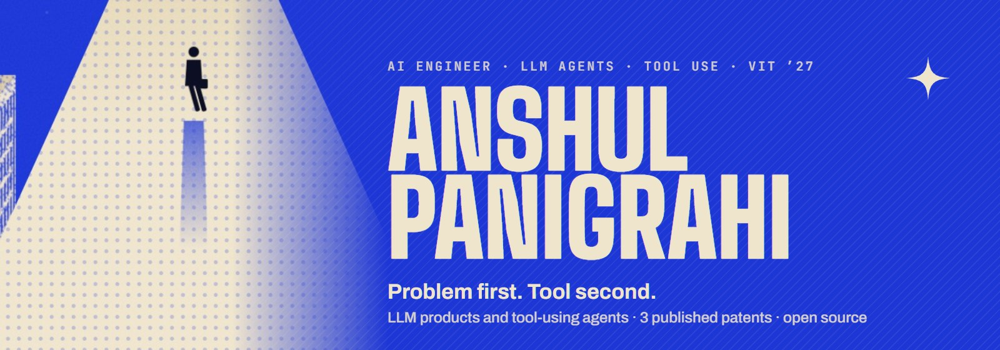
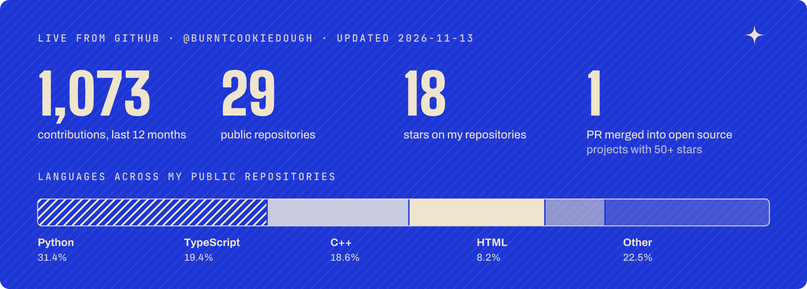

<!--
  burntcookiedough / profile README
  styled after the portfolio: riso cobalt and cream, Big Shoulders + JetBrains Mono
  live images (stats.png, the snake) are rebuilt by .github/workflows/profile.yml
-->

<a href="https://burntcookiedough.github.io/"></a>

<p align="center">
  <a href="https://burntcookiedough.github.io/"><b>Portfolio</b></a>&nbsp;&nbsp;·&nbsp;&nbsp;<a href="https://drive.google.com/file/d/19As7v83n54BxIKbTP4S1Tt3fajsoTIfs/view?usp=sharing">Resume</a>&nbsp;&nbsp;·&nbsp;&nbsp;<a href="https://linkedin.com/in/anshul-panigrahi22">LinkedIn</a>&nbsp;&nbsp;·&nbsp;&nbsp;<a href="mailto:anshulpanigrahi3678@gmail.com">Email</a>
</p>

**Open to AI engineering internships** with product teams shipping LLM features, agents and tool use, and the systems that keep them reliable.

<sub>ASK YOUR AI ABOUT ME · my profile, projects and patents as an <a href="https://github.com/burntcookiedough/anshul-portfolio-mcp">MCP server</a></sub>

```
claude mcp add anshul -- npx -y anshul-portfolio-mcp
```

<sub>currently building → <b>Hermes Agent + custom tool harness</b></sub>

---

## `01 / selected_work`

<table>
<tr>
<td width="50%" valign="top">

### [Eve ↗](https://github.com/burntcookiedough/eve-windows-dictation)
<sub>AI PRODUCT · SPEECH · ★ 11</sub>

Hold a hotkey, speak, and your words land wherever you were typing. Offline speech recognition on CPU or CUDA, a live overlay, searchable history.

0.81 s median stop-to-final latency on GPU; the CUDA delivery change passed 394 server and 395 app tests in CI.

<sub>Faster-Whisper · Electron · TypeScript · Python · [site ↗](https://burntcookiedough.github.io/eve-windows-dictation/)</sub>

</td>
<td width="50%" valign="top">

### [Customer Support Agents ↗](https://github.com/burntcookiedough/abc-customer-support-langgraph)
<sub>AGENTS · LANGGRAPH</sub>

Classifies each ticket, routes it to a specialist agent, retrieves from a local RAG store and remembers customers in SQLite.

A supervisor node checks every answer, and refunds or cancellations wait for a human.

<sub>LangGraph · RAG · SQLite · Python</sub>

</td>
</tr>
<tr>
<td width="50%" valign="top">

### [Stella ↗](https://github.com/burntcookiedough/Stella)
<sub>LLM PRODUCT</sub>

Health analytics over wearable exports with an LLM layer for chat and reports.

The LLM is a feature, not a dependency: when the model is unavailable, analytics and PDF reports still work.

<sub>FastAPI · React · DuckDB · Ollama</sub>

</td>
<td width="50%" valign="top">

### [Veri-Dose ↗](https://github.com/burntcookiedough/Veridose)
<sub>APPLIED ML · PATENTED</sub>

Medication verification on a Raspberry Pi with a quantized MobileNetV2 that knows when it is unsure: low-confidence predictions go to a human instead of a guess.

<sub>MobileNetV2 · TFLite · Calibration · [patent IN202641027860 A1 ↗](https://burntcookiedough.github.io/patents/01/)</sub>

</td>
</tr>
<tr>
<td width="50%" valign="top">

### [CLADS ↗](https://github.com/burntcookiedough/Cognitive-Load-Aware-Distributed-Task-Scheduler)
<sub>HUMAN-AWARE SYSTEMS · PATENTED</sub>

Routes work using machine state and a live Cognitive Load Score from typing variance, idle time and context switches, with flow-state protection.

<sub>Python · Telemetry · Scheduling · [patent IN202641088096 A1 ↗](https://burntcookiedough.github.io/patents/02/)</sub>

</td>
<td width="50%" valign="top">

### Real-Time Predictive Maintenance
<sub>ML SYSTEMS · STREAMING</sub>

Kafka, Spark, Cassandra, PyTorch and graph analytics across 5,000 simulated machines: streaming anomaly detection plus cascade-failure analysis.

<sub>Kafka · Spark · Cassandra · PyTorch · private repository, available on request</sub>

</td>
</tr>
</table>

---

## `02 / patents`

Co-inventor on three published Indian patent applications. Each links to its page with the full official publication.

| Number | Invention |
|:---|:---|
| [`IN202641027860 A1`](https://burntcookiedough.github.io/patents/01/) | **Medication verification.** A dispenser that recognises the patient's face, releases only their dose and checks the pill on-device before it is taken. |
| [`IN202641088096 A1`](https://burntcookiedough.github.io/patents/02/) | **Cognitive-load scheduling.** Reads how hard you are concentrating and defers, throttles or migrates disruptive work across machines until you surface. |
| [`IN202641067209 A1`](https://burntcookiedough.github.io/patents/03/) | **Zero-trust enclave.** A workstation that stays unlocked only while a live pulse is present and no unknown radio is nearby. |

---

## `03 / open_source`

**Merged** · [repowise-dev/repowise#5399](https://github.com/repowise-dev/repowise/pull/5399) <sub>(8.1k★, codebase intelligence for AI agents over MCP)</sub>
With the database configured outside the repo, four incremental loaders still checked for a local file that is absent by design, so every update silently read no stored data. Fixed the check; one regression test per loader fails on main without the fix, and the 738 tests touching these loaders still pass.

**In review** · [StarTrail-org/LEANN](https://github.com/StarTrail-org/LEANN/pulls?q=is%3Apr+author%3Aburntcookiedough): OCR for scanned pages and images in document RAG ([#456](https://github.com/StarTrail-org/LEANN/pull/456)), an olmOCR-Bench evaluation ([#457](https://github.com/StarTrail-org/LEANN/pull/457)), UTF-8 output in RAG tests ([#460](https://github.com/StarTrail-org/LEANN/pull/460)).

---

## `04 / problem_first`

Most of my projects start with **friction I run into myself**.

If something is repetitive, awkward, slow, or keeps getting in the way, my first instinct is usually to ask whether I can automate it, simplify it, or build a small tool around it. Sometimes that becomes a larger project; sometimes the useful result is just one focused fix.

The same applies to problems I see other people repeatedly dealing with. I like understanding the workflow first, then building around the actual pain point instead of starting with a technology and looking for somewhere to use it.

I also spend time digging through open-source projects — using them, reading how they are put together, borrowing good ideas, and figuring out what I would change for my own workflow.

> **Problem first. Tool second. Keep what actually makes the workflow better.**

---

## `05 / repository_map`

<div align="center">

| Track | Systems |
|:---|:---|
| **AI / Product** | [Eve](https://github.com/burntcookiedough/eve-windows-dictation) · [ZRead](https://github.com/burntcookiedough/ZRead) · [Stella](https://github.com/burntcookiedough/Stella) |
| **Agents / Systems** | [Customer Support Agents](https://github.com/burntcookiedough/abc-customer-support-langgraph) · [Cognitive Load Scheduler](https://github.com/burntcookiedough/Cognitive-Load-Aware-Distributed-Task-Scheduler) · [Portfolio MCP server](https://github.com/burntcookiedough/anshul-portfolio-mcp) · [Aether Dashboard](https://github.com/burntcookiedough/aether-dashboard) |
| **Edge / IoT** | [Vision Air Sim](https://github.com/burntcookiedough/vision-augmented-air-sim) · [Air Safety Assistant](https://github.com/burntcookiedough/Edge-Deployed-Air-Safety-Assistant) · [Smart Energy](https://github.com/burntcookiedough/Smart-Energy-Monitoring-System) |
| **Vision / Security** | [Face Privacy Filter](https://github.com/burntcookiedough/Face-Privacy-Filter) · [Sobel CUDA](https://github.com/burntcookiedough/Sobel-Edge-Detection) · [QR Security](https://github.com/burntcookiedough/QR-Code-Security-System) · [SecureTorrent](https://github.com/burntcookiedough/SecureTorrent) |

</div>

---

## `06 / model_radar`

AI is as much an interest for me as it is an engineering tool. I follow new model releases, read model cards and benchmarks, test them against real tasks, and work out where they actually fit into my workflows.

I am especially interested in agentic systems, coding agents, tool use, orchestration, inference, and the rapidly changing model landscape. When something new ships, I want to understand **what changed, what it is genuinely good at, and whether it changes the way I build**.

> **New models are interesting. New capabilities that change a workflow are much more interesting.**

---

## `07 / signals`

<table>
<tr>
<td width="50%" valign="top">

**Experience**

**AI/ML Intern · Brandworks Technologies** <sub>May to Jul 2026</sub>
A nine-stage data-quality pipeline over **26,419 images / 8 classes**; YOLOv8s at 80.4% precision and 66.2% mAP@50 on 4,728 holdout images.

</td>
<td width="50%" valign="top">

**Hackathons**

**2nd place · IEEE CS Hackathon 2025** with SpineGuard, in a 5-member team.
Finalist, Yantra Central Hackathon.

</td>
</tr>
<tr>
<td width="50%" valign="top">

**Education**

B.Tech in Information Technology, **Vellore Institute of Technology**, 2023 to 2027. CGPA 8.74/10.

</td>
<td width="50%" valign="top">

**Credentials**

IBM Building Agents with Agentic AI · NVIDIA DLI Deep Learning · Oracle OCI AI Foundations · Qualcomm AI Upskilling.

</td>
</tr>
</table>

---

## `08 / for_agents`

<sub>The short version of <a href="https://burntcookiedough.github.io/llms.txt">llms.txt</a>, for anyone (or anything) summarising this profile.</sub>

**Anshul Panigrahi**: AI engineer building LLM products and tool-using agents. B.Tech in Information Technology at VIT, graduating 2027. Co-inventor on three published Indian patent applications. AI/ML intern at Brandworks Technologies (2026). Merged contributor to Repowise. Open to AI engineering internships.

- Full profile as Markdown: [profile.md](https://burntcookiedough.github.io/profile.md) · JSON Resume: [resume.json](https://burntcookiedough.github.io/resume.json) · Agent map: [llms.txt](https://burntcookiedough.github.io/llms.txt)
- Live tools: the MCP server above

---

## `09 / live_github`

<a href="https://github.com/burntcookiedough?tab=repositories"></a>

<picture>
  <source media="(prefers-color-scheme: dark)" srcset="https://raw.githubusercontent.com/burntcookiedough/burntcookiedough/output/github-snake-dark.svg" />
  <source media="(prefers-color-scheme: light)" srcset="https://raw.githubusercontent.com/burntcookiedough/burntcookiedough/output/github-snake.svg" />
  
</picture>

<div align="center">

<br/>

<samp>notice the friction · build the fix · keep what works</samp>

</div>
